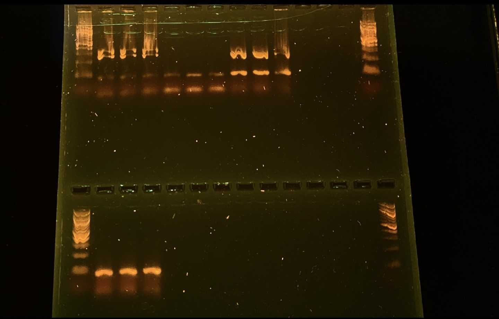

Is it me or the reagents! Let's find out
# Samples 
278 (old supplies) = 1-3
Neg old supplies = 4-6
278 (new supplies) = 7-9
Neg new supplies = 10-12
# Master Mix Table
HotStart library prep calc in mm_calcs is where this came from
- **Mix the following agents via vortex:** Buffer, primers
0N primers were used for this
Primer 

|   |   |   |   |
|---|---|---|---|
|Reagent|Amount per 1 rxn (uL)|MasterMix Amount (uL) + 5%|Triplicate (uL) + 5%|
|Buffer|5|10.5|31.5|
|dNTP (10mM)|0.5|1.05|3.15|
|F Primer (10uM)|1|2.1|6.3|
|R Primer (10uM)|1|2.1|6.3|
|Polymerase|0.25|0.525|1.575|
|Albumin|0.25|0.525|1.575|
|Water|16|33.6|100.8|
|DNA|1|||
|Total|25|50.4|151.2|

# Photo of Gel
Ran for 35 minutes @ 110v

I think my top row wells collapsed, but all the same sample.

278 (old supplies) = 1-3
Neg old supplies = 4-6
278 (new supplies) = 7-9
Neg new supplies = 10-12

