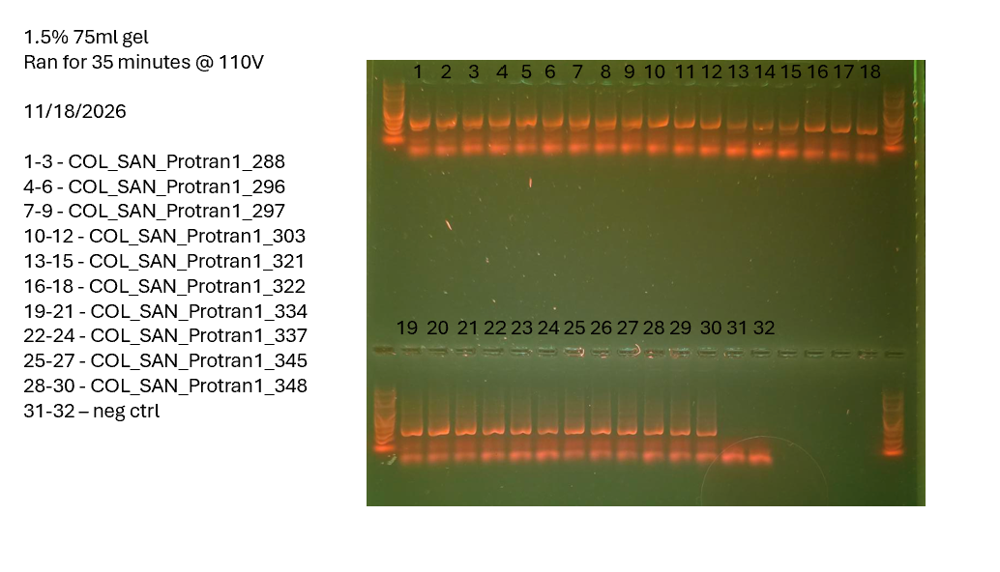

Made primer dilutions today, 2 tubes of each XN totalling 150ul (15ul primer/135ul water).
# Samples 

288 1-3
296 4-6
297 7-9
303 10-12
321 13-15
322 16-18
334 19-21
337 22-24
345 25-27
348 28-30
Negs 31-32
# Master Mix Table
HotStart library prep calc in mm_calcs is where this came from
- **Mix the following agents via vortex:** Buffer, primers
1N primers were used for this - block B
Primer 

|                 |                       |                            |                      |
| --------------- | --------------------- | -------------------------- | -------------------- |
| Reagent         | Amount per 1 rxn (uL) | MasterMix Amount (uL) + 5% | Triplicate (uL) + 5% |
| Buffer          | 5                     | 57.75                      | 173.25               |
| dNTP (10mM)     | 0.5                   | 5.775                      | 17.325               |
| F Primer (10uM) | 1                     | 11.55                      | 34.65                |
| R Primer (10uM) | 1                     | 11.55                      | 34.65                |
| Polymerase      | 0.25                  | 2.8875                     | 8.6625               |
| Albumin         | 0.25                  | 2.8875                     | 8.6625               |
| Water           | 16                    | 184.8                      | 554.4                |
| DNA             | 1                     |                            |                      |
| Total           | 25                    | 277.2                      | 831.6                |
# Photo of Gel
Ran for 35 minutes @ 110v
